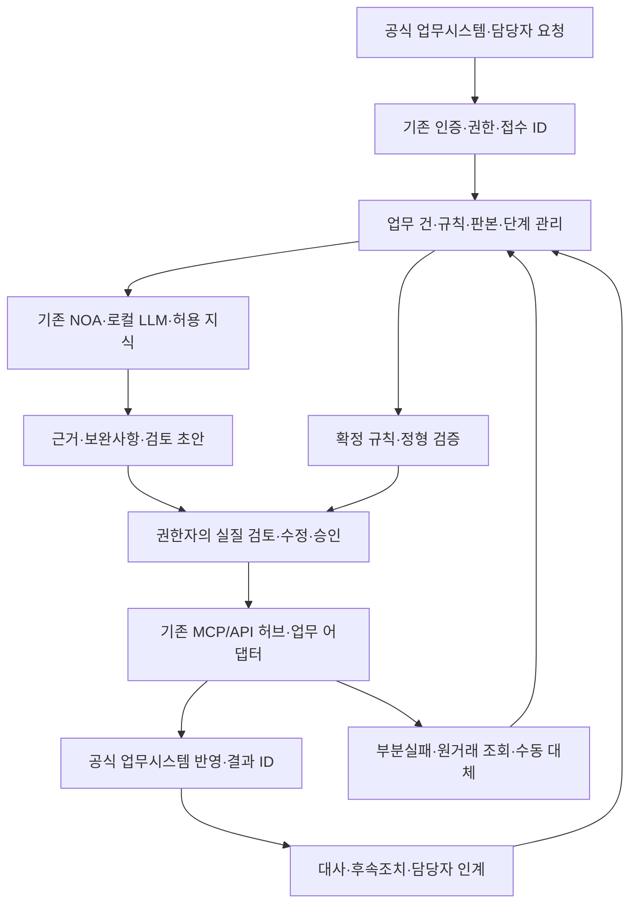

# 2027 TS 전사 NOA 기반 업무흐름 고도화 · 2차 AX+SI 사업기획 v0.4

- 기준일: 2026-10-12 / 상태: 공고 미매핑 기획·RFP 초안 / 현업 피드백 없음
- 목적: 국민의 재제출·잘못된 이관·처리 누락 위험 완화와 현업의 안전·품질·책임 있는 업무 완료 지원
- 목표: 업무 건별 근거·담당·기한·보완·승인·공식 결과의 추적 및 후속조치 누락 검증. 기준선·개선율은 미측정, 아래 통제 검수안은 제안 기준
- 수단: 기존 TS AI 플랫폼·NOA·로컬 LLM·지식·권한·MCP/API 재사용 + 업무별 규칙/상태/연계/검증의 부족분 보강
- 범위: 민원에 한정하지 않은 전략·경영지원·도로교통·검사·자격·교육·모빌리티·항공철도·연구·결함·인증·감사·보안·공개 업무
- 조사 모집단: 보관 원장 226조직·74처(본사/KATRI 51 + 지역 21 + 체험교육 2). 오늘 8개 최상위 기관 첫 페이지와 조직목록 선택 대조, 조직목록 227개·AI서비스개발팀 추가 확인. 모든 담당업무 전 페이지 최신 재수집 완료와 구분
- 가정: 기존 서버·로컬 LLM·신규 인프라 구입 0원 전제. 자원 부족 시 범위 축소·일정/부하 조정 및 별도 의사결정. 라이선스·추가 저장·백업·설정·시험·운영 비용 미산정, 총비용 0원 아님
- 별도 독립 R&D·비전·센서·장비제어 제외. AI PMS는 전사 워크플로우의 사업관리 적용 사례, 감리엔진 연구는 별도 기획 이력으로 분리
- 제안 제품 기능·RFP 요구·최종 계약·설치본·실측 성과의 구분. RFP만으로 NOA의 해당 기능 미지원/납품 완료를 단정하지 않는 기준

## 1. 문제·필요성·대안

- 문제 가설: 규정 질의·문서 초안 이후 필요한 자료 보완, 타 부서 검토, 승인, 공식 원장 반영, 후속조치가 여러 도구와 담당자 사이에서 끊기는 상황
- 국민 편익: 재문의·재제출·반복서류·불명확한 진행상태의 개선 가능성. 실제 빈도·효과와의 구분
- 현업 편익: 근거 탐색·자료 재입력·보완 추적 부담 완화 및 전문 판단·검토 품질 유지. 시간 절감을 감축 인원으로 환산하지 않는 기준
- 대안 A: 현행 시스템·운영 보강 / B: 동일 절차·서식·권한의 규칙형 흐름 / C: B + NOA의 비정형 자료 이해·근거·보완·초안
- 권고: C를 제한 적용하되 규칙·공식 원장·권한자가 기한/점수/정산/합격/인증을 결정. AI가 필요 없는 정형계산·원장대사는 B로 구현
- 별도 2차 발주 조건: 기존 계약·기술협상·변경·유지관리 범위를 먼저 대조하고 새 대상·납품물·증분·효과·기간을 확정. 자의적 계약 분할 금지

## 2. 기존 구축 제외·재사용·증분 경계

2026.6 공통플랫폼 RFP 원문 재대조. 최종 계약·설치·검수는 미확보. 기존 기능과 동일한 납품은 새 개발비에서 제외, 업무별 설정/새 데이터/연계/회귀시험은 실제 작업과 기존 계약 포함 여부를 확인한 뒤 증분 산정.

| ID | 기존 요구 | 원문 범위 | 2차 제외·재사용 | 증분 후보 | 착수 전 대조 |
| --- | --- | --- | --- | --- | --- |
| D01 | SFR-001 | 온나라·EP·통합경영 지식 파이프라인 | 동일 구축·수집·RAG 재구축 제외 | 업무 건 ID·승인판본·결과대사 연결 차이분 | 최종 계약·연계규격·지식권한·판본 |
| D02 | SFR-002 | 외부 탐색·법령/뉴스·수집이력·브리핑 | 동일 탐색·스케줄러·출처관리 제외 | 업무 규칙의 확정판본·변경영향 검토 | 소스 라이선스·반영/승인 절차 |
| D03 | SFR-003 | 검사 Q&A·상시감사·보도자료 초안 3건 | 동일 챗봇·법령분석·초안 생성 제외 | 질문 이후 보완·조치·검토·종결·공개 이행 추적 | 특화서비스 실제 기능·처별 사용권 |
| D04 | SFR-004 | 통합권한·데이터등록·서비스관리·사용자/관리자 이벤트로그 | 권한체계·일반로그 재구축 제외 | 승인대상 해시·실행 직전 권한·업무 건의 정책판본 연결 | 현재 이벤트필드·보존정책·권한시스템 |
| D05 | SFR-005 | 후속 질의·답변 편집·북마크 | 대화 편의기능 재납품 제외 | 담당·기한·단계·완료증거를 갖는 업무 후속조치 | 현재 대화와 업무 객체의 실제 관계 |
| D06 | SFR-006/007 | 상담·신문고 답변/검토·권한·로그 | 동일 답변 생성·검토 기능 제외 | 소관 재이관·보완·기한·통지·종결 연결 증분 | 민원 서비스 구현·공식 원장 연계 |
| D07 | SFR-008/009 | 전세버스 공시 판별·승인가능 답변·수동검토·선택반영·DB저장·보고 | 동일 사람검토·선택반영·DB연동·보고 제외 | 추가 업무 대상/판본/이행추적 차이분만 편성 | 공시 기능 상세·최종계약·확장 대상 |
| D08 | SIR-001/002 | 기존 API Gateway·표준 MCP허브·설정확장·OpenAPI→Tool | 허브·표준 도구 변환 재구축 제외 | 업무별 호출계약·멱등키·상태대사·복구 차이분 | 실제 허브 API·인증·확장권·운영제약 |
| D09 | INR-003/보안·시험·운영 요구 | 연계호환·정합성·암호화·품질·시험 | 기본 연계보안·품질을 신기능으로 재계상 제외 | 새 업무·데이터·권한 경로의 증분 시험 | 72건 원문 전체·협상·검수·제품회귀 범위 |
| D10 | PMR-007 | AI구축 투입공수 산정 관련 요구 | 일률적 FP 전환·동일 작업 FP/MM 이중계상 제외 | SI 기능·AI 구성·설정·검증의 산정경계 승인 | 후속발주 산정방법·최신 단가·단위 |

## 3. 하나의 사업·공통 기반·6개 업무팩

| 팩 | 편성 | 적용영역 | 기본 흐름 |
| --- | --- | --- | --- |
| P0 | 공통 업무흐름·운영통제 | 전사 공통 | 업무 건·판본·담당·기한·보완·승인·실행·결과·인계의 최소 공통 구조 |
| P1 | 전략·사업·계약·재무·지원 | 경영·연구 지원 | 사업요구→계획·예산→발주·계약→수행·검수→청구 검토→공식 지급결과→성과 |
| P2 | 도로교통·검사·자격·교육 | 본사·지역·검사소·센터 | 신청/대상확인→자료보완→검사·시험·교육 일정→전문 판단→결과등록→후속조치 |
| P3 | 모빌리티·데이터·정책·실증 | 모빌리티교통안전 | 자료요청→자료 품질·근거확인→협의·변경관리→실증/정책검토→보고·후속조치 |
| P4 | 항공·드론·철도 안전 | 항공철도안전 | 신청/보고→요건·범위 확인→분야검토→보완·현장점검→권한자 승인→후속조치 |
| P5 | 자동차 연구·결함·인증 | 자동차안전연구원 | 조사/시험/인증접수→기준판본·증거확인→시험계획→전문검토→결과보고→추적·보완 |
| P6 | 감사·보안·AI·공개 책임 | 감사·디지털·직속실 | 검토요청→조건·근거검토→조치·반론→승인→실행/공개→종결증거·회귀확인 |

- 단일 공통 기반과 업무팩별 설정·데이터·연계·검수 과업의 편성. 처별로 같은 엔진·화면·로그·승인모듈을 반복 발주하지 않는 기준
- 전사 조사와 전사 동시 구축의 구분. 2027 실제 시범/확대 대상은 비용·수요·권한·API·기준선 확보 후 선정
- 후보 순서: 자료/조치 추적형 → 보완/다부서 인계형 → 승인·제한쓰기형. 안전·자격·인사·평가·지급의 최종 판단은 공식 권한 유지

## 4. End-to-End 아키텍처·데이터·권한

- NOA 확인 기능: 공급사 소개의 Understand/Connect/Execute/Govern. TS 설치본/API/제품판본 확인 전 지원기능 확정 금지
- aRDa 등 보조 제품: 파싱/정비 등 해당 제품의 공식 기능·판본·사용권 확인 후 필요한 역할만 배치, NOA 기본기능과 동일 작업 이중 산정 금지. 이번 원문 조사로 aRDa 특정 성능·배포를 확정하지 않는 기준
- 업무 건 필드: caseId·officialReceiptId·orgCode·workflowId·stepId·status·assigneeRole·ruleVersion·documentVersion·dueDateType·dueDate·approvalTargetHash·officialResultId·errorCode·handoffId
- 승인 연결: 근거 원문 접근·중요 입력 확인·수정/반려 후 승인. 수취인/금액/기준판본 변경 시 이전 승인 무효
- 연계: 조회 우선, 쓰기는 API 계약·승인·멱등·복구·실행직전 권한 확보 범위만. API 미제공 시 승인된 파일 내보내기/수동등록과 결과 대사. 인증 우회·무단 RPA 제외
- 공식 원장: EP/온나라/통합경영·VIMS·ARTS·TIMS·사이버검사소·연구/시험/인증/리콜 등은 업무별 확인할 연계 대상. API 존재·쓰기 권한 미확인
- RealPMS: 보고 의무·대상 과업이 확인된 업무만 별도 보고 어댑터 적용. 국토부 시스템 재구축·공단 전체 의무 보고 가정 제외
- 예외: 자료권리 없음·악성문서지시·권한회수·판본변경·중복/유실·부분성공·시간초과·담당변경·현장오프라인·공식원장 불일치의 보류/재검토/대사/수동인계
- 역할: 신청/작성·업무검토·공식승인·시스템운영·보안/감사 분리. 기관·지자체·사업자·위원회의 결정을 TS 권한으로 추정하지 않는 기준
- 개인정보: 인사/급여/건강/평가/제안서/조사자료의 목적별 분리·최소화·검색/생성/다운로드 권한 동일 통제, 필요 시 영향평가·고영향 판단 등 현행 적용조건 검토
- 법령: 개별법·위탁/수탁·내규·전결·기록/보존의 업무별 매핑표 납품. 담당업무 기재는 법적 권한 증거와 구분. 민원 연장/장애기간은 해당 민원에만 적용

## 5. 처별 적용업무 요약

| 조직·코드 | 팩 | 적용업무 제안 | 업무별 증분 |
| --- | --- | --- | --- |
| 교육운영처(상주) 8010000 | P2 | 정밀검사·국가자격·시험 / 체험·안전·경제운전 교육 / 행정·회계·계약 / 차량·시설·안전보건·보안 | 유형별 요건·보완·결과대사·정정 설정; 센터/지역 과정·일정·결과·인계 설정; P1 재사용·지역/센터 서식·권한 증분; 자산/안전 공통팩 재사용·센터별 대상·조치 연결 |
| 교육운영처(화성) 6010000 | P2 | 체험·안전·경제운전 교육 / 행정·회계·계약 / 차량·시설·안전보건·보안 | 센터/지역 과정·일정·결과·인계 설정; P1 재사용·지역/센터 서식·권한 증분; 자산/안전 공통팩 재사용·센터별 대상·조치 연결 |
| 감사처 1014010 | P6 | 감사 지적·반론·조치 종결 | 상시감사 질의 재구축 제외·지적별 조치/종결 연결 |
| 운영지원처 1018030 | P1 | 문서배부·기록물·정보공개·현장지원 | 미배부·재이관 추적·보존등급·후속조치 연결 |
| 인재개발처 1018037 | P1 | 채용·교육·근태·급여 검토 | 민감자료 분리·변경사유 검토·인사행위 승인대상 고정 |
| 재정회계처 1018034 | P1 | 입찰·계약·검수·선금/기성/잔금 검토 | 업체별 버전아카이브·검수/청구 연결·기지급 차감 대사 |
| 자산인프라처 1016049 | P1 | 시설·건설·유지관리 후속조치 | 시설별 조치·작업허가·점검증거 연결 |
| 안전관리처(서울) 3402020 | P2 | 지도·단속·교통수단 점검 | 현장조치·책임·본사인계 설정 |
| 안전사업1처(서울) 3402040 | P2 | 지도·단속·교통수단 점검 / 정밀검사·국가자격·시험 / 기기정도검사 / 행정·회계·계약 | 현장조치·책임·본사인계 설정; 유형별 요건·보완·결과대사·정정 설정; 기기-기준-원기록-결과 대응; P1 재사용·지역/센터 서식·권한 증분 |
| 안전사업2처(서울) 3402041 | P2 | 주차장·내압용기 검사 / 체험·안전·경제운전 교육 | 검사유형별 서식·조건·결과·조치 설정; 센터/지역 과정·일정·결과·인계 설정 |
| 안전관리처(경기남부) 3406050 | P2 | 지도·단속·교통수단 점검 / 체험·안전·경제운전 교육 | 현장조치·책임·본사인계 설정; 센터/지역 과정·일정·결과·인계 설정 |
| 안전사업처(경기남부) 3406040 | P2 | 정밀검사·국가자격·시험 / 주차장·내압용기 검사 / 기기정도검사 / 궤도·삭도 검사 / 행정·회계·계약 | 유형별 요건·보완·결과대사·정정 설정; 검사유형별 서식·조건·결과·조치 설정; 기기-기준-원기록-결과 대응; 궤도/삭도 조건·서식·검토·조치 연결; P1 재사용·지역/센터 서식·권한 증분 |
| 안전관리처(대전세종충남) 3412050 | P2 | 지도·단속·교통수단 점검 / 체험·안전·경제운전 교육 | 현장조치·책임·본사인계 설정; 센터/지역 과정·일정·결과·인계 설정 |
| 안전사업처(대전세종충남) 3412040 | P2 | 정밀검사·국가자격·시험 / 주차장·내압용기 검사 / 기기정도검사 / 행정·회계·계약 | 유형별 요건·보완·결과대사·정정 설정; 검사유형별 서식·조건·결과·조치 설정; 기기-기준-원기록-결과 대응; P1 재사용·지역/센터 서식·권한 증분 |
| 안전관리처(대구경북) 3408050 | P2 | 지도·단속·교통수단 점검 | 현장조치·책임·본사인계 설정 |
| 안전사업처(대구경북) 3408040 | P2 | 정밀검사·국가자격·시험 / 주차장·내압용기 검사 / 기기정도검사 / 행정·회계·계약 | 유형별 요건·보완·결과대사·정정 설정; 검사유형별 서식·조건·결과·조치 설정; 기기-기준-원기록-결과 대응; P1 재사용·지역/센터 서식·권한 증분 |
| 안전관리처(부산) 3404050 | P2 | 지도·단속·교통수단 점검 | 현장조치·책임·본사인계 설정 |
| 안전사업처(부산) 3404040 | P2 | 정밀검사·국가자격·시험 / 주차장·내압용기 검사 / 기기정도검사 / 행정·회계·계약 | 유형별 요건·보완·결과대사·정정 설정; 검사유형별 서식·조건·결과·조치 설정; 기기-기준-원기록-결과 대응; P1 재사용·지역/센터 서식·권한 증분 |
| 안전관리처(광주전남) 3410050 | P2 | 지도·단속·교통수단 점검 | 현장조치·책임·본사인계 설정 |
| 안전사업처(광주전남) 3410040 | P2 | 정밀검사·국가자격·시험 / 주차장·내압용기 검사 / 기기정도검사 / 체험·안전·경제운전 교육 / 행정·회계·계약 | 유형별 요건·보완·결과대사·정정 설정; 검사유형별 서식·조건·결과·조치 설정; 기기-기준-원기록-결과 대응; 센터/지역 과정·일정·결과·인계 설정; P1 재사용·지역/센터 서식·권한 증분 |
| 안전관리처(경기북부) 3407060 | P2 | 지도·단속·교통수단 점검 / 정밀검사·국가자격·시험 / 주차장·내압용기 검사 | 현장조치·책임·본사인계 설정; 유형별 요건·보완·결과대사·정정 설정; 검사유형별 서식·조건·결과·조치 설정 |
| 안전관리처(인천) 3418060 | P2 | 지도·단속·교통수단 점검 / 정밀검사·국가자격·시험 / 주차장·내압용기 검사 / 행정·회계·계약 | 현장조치·책임·본사인계 설정; 유형별 요건·보완·결과대사·정정 설정; 검사유형별 서식·조건·결과·조치 설정; P1 재사용·지역/센터 서식·권한 증분 |
| 안전관리처(강원) 3414060 | P2 | 지도·단속·교통수단 점검 / 정밀검사·국가자격·시험 | 현장조치·책임·본사인계 설정; 유형별 요건·보완·결과대사·정정 설정 |
| 안전관리처(충북) 3420060 | P2 | 지도·단속·교통수단 점검 / 정밀검사·국가자격·시험 / 행정·회계·계약 | 현장조치·책임·본사인계 설정; 유형별 요건·보완·결과대사·정정 설정; P1 재사용·지역/센터 서식·권한 증분 |
| 안전관리처(전북) 3416060 | P2 | 지도·단속·교통수단 점검 / 정밀검사·국가자격·시험 / 주차장·내압용기 검사 / 체험·안전·경제운전 교육 | 현장조치·책임·본사인계 설정; 유형별 요건·보완·결과대사·정정 설정; 검사유형별 서식·조건·결과·조치 설정; 센터/지역 과정·일정·결과·인계 설정 |
| 안전관리처(경남) 3409060 | P2 | 지도·단속·교통수단 점검 / 정밀검사·국가자격·시험 / 주차장·내압용기 검사 | 현장조치·책임·본사인계 설정; 유형별 요건·보완·결과대사·정정 설정; 검사유형별 서식·조건·결과·조치 설정 |
| 안전관리처(울산) 3405060 | P2 | 지도·단속·교통수단 점검 / 정밀검사·국가자격·시험 / 행정·회계·계약 | 현장조치·책임·본사인계 설정; 유형별 요건·보완·결과대사·정정 설정; P1 재사용·지역/센터 서식·권한 증분 |
| 안전관리처(제주) 3422060 | P2 | 지도·단속·교통수단 점검 / 정밀검사·국가자격·시험 / 차량·시설·안전보건·보안 | 현장조치·책임·본사인계 설정; 유형별 요건·보완·결과대사·정정 설정; 자산/안전 공통팩 재사용·센터별 대상·조치 연결 |
| 연구기획처 7418020 | P1 | 연구과제 기획·예산·출연금·연차보고 | AI PMS 재사용·과제별 산출물/보고 프로파일 |
| 연구지원처 7418030 | P1 | 연구원 계약·건설·시설·회계 지원 | 재정회계 공통팩 재사용·연구원 서식/권한 증분 |
| 결함정책처 7419030 | P5 | 리콜 정책·통지·제작자 사후관리 | 결함정보-조사-통지-사후관리 증거 연결 |
| 결함조사1처 7419000 | P5 | 제작결함 조사 자료·조치관리 | 조사건별 증거계보·질문·보완·판본 추적 |
| 결함조사2처 7419020 | P5 | 제작결함·화재 조사 | 증거보존·분석이견·보완·재검토 흐름 |
| 안전연구처 7414000 | P5 | 안전도평가·충돌/배터리 시험자료 | 시험건-기준-원성적-보고 대응·누락검출 |
| 미래차연구처 7417000 | P5 | Green NCAP·연비·배출·실내공기 연구 | 평가기준판본·시험산출물·보고 연결 |
| 부품연구처 7423000 | P5 | 부품안전·자기인증 시험지원 | 시료-시험기준-성적-인증검토 연결 |
| 자율주행연구처 7422010 | P5 | 임시운행·성능인증·시범지구 자료검토 | 안전운행 요건-증거-이행 조건 연결 |
| 커넥티드카연구처 7422020 | P5 | 사이버보안·SW업데이트·공유데이터 | 판본별 위협/조치 증거·제공조건 관리 |
| 자율주행실증처 7422030 | P5 | K-City·실증도시·리빙랩 운영지원 | 실증사업 공통팩 재사용·시설이용/안전조건 증분 |
| 자동차인증처 7421000 | P5 | 제작자등록·기술검토·제원통보 | 문서요건·제원불일치·공식통보 인계 |
| 건설기계인증처 7421020 | P5 | 형식승인·확인검사·결함조사 지원 | 형식/확인검사별 근거·보완·판본 연결 |
| 경영기획처 1016020 | P1 | 전략과제·지시사항 이행 | 지시-과제-담당-조치증거 연결 및 재개방 규칙 |
| 예산처 1016050 | P1 | 예산요구·변경·조직영향 검토 | 동일과업 이중요구 탐지·예산판본 변경 영향표 |
| 혁신성과처 1016042 | P1 | 평가·공시 계량성과 증거관리 | 산식·기간·분모·판본 연결 및 누락보완 흐름 |
| ESG경영처 1016047 | P6 | 고객경험·윤리인권·이사회 후속조치 | 의견-개선과제-증거 연결·비공개 안건 접근분리 |
| 디지털기획처 1019300 | P6 | 정보화 변경·개인정보·유지관리 검토 | 변경승인과 실제판본 결합·수동 복구 인계 |
| AI혁신처 1019600 | P6 | AI 서비스·데이터·평가 운영 | 업무별 평가·실패회귀·배포판본 추적 |
| 정보보안처 1019500 | P6 | 보안 검토·취약점 조치 | 정책판본-권한회수-실행차단·조치기한 연결 |
| 자동차정보처 1019400 | P6 | 자동차정보 운영·자료품질 | 자료변경 영향·외부배포 판본·정정통보 |
| 모빌리티연구처 1019020 | P3 | TIMS·앱미터·정책/연구 협의 | 검정/연구 과제별 자료·협의·후속조치 추적 |
| 데이터융복합처 1019030 | P3 | 교통데이터 제공·품질·분석 후속조치 | 제공조건·결측/오류 보완·정정전파·동일자료 재사용 |
| 교통안전처 1022030 | P2 | 운수업체 안전점검·진단·후속조치 | 업체별 점검조치 연결·미완료 사유·재점검 |
| 자격교육처 1022010 | P2 | 운수자격·교육·운전적성 업무지원 | 서류보완·예약/이수 인계·기준판본 연결 |
| 기후탄소물류처 1019040 | P3 | 탄소·물류 사업자료 검토 | 집계근거·자료판본·불일치 보완·보고연결 |
| 정책지원처 1019010 | P3 | 모빌리티 정책·지자체 협의 | 기관별 역할·협의쟁점·후속조치 연결 |
| 규제혁신처 1021020 | P3 | 규제샌드박스 조건 이행 | 조건-증거-이행기한 대응·조건변경 재검토 |
| 실증사업처 1021030 | P3 | 실증 협약·계획·변경·결과관리 | 기관별 제출·변경·위험조치·인계 추적 |
| 검사기획처 1028070 | P2 | 검사 제도·업무기준·지역 이행 | 기준판본-현장 적용-예외 문의 추적 |
| 특수검사처 1042721 | P2 | 특수검사 접수·자료·후속조치 | 유형별 체크리스트·보완·결과원장 대사 |
| 주차안전처 1028030 | P2 | 기계식주차장 검사·심사·사고·교육 | 심사분야별 자료·현장조치·자격교육 연결 |
| 첨단검사전략처 1029010 | P2 | KADIS·KAVIC 교육·해외사업 관리 | 교육·해외사업·시스템 변경별 제출·성과 연결 |
| 첨단연구개발처 1029020 | P2 | 배터리 인증·이력 및 연구자료 | 배터리 건별 자료/판본·연구 산출물 대응 |
| AI검사인프라처 1029050 | P2 | VIMS·예약·검사 SW 변경관리 | 원장/예약 연계의 차이분·변경회귀·복구 추적 |
| 기술안전처 1028110 | P2 | 튜닝교육·안전단속·수시점검 지원 | 행정 자료·조치·교육이력 연결 |
| 시험인증처 1028120 | P2 | 튜닝부품 시험·인증 지원 | 시험의뢰-성적판본-보완-인증 결과 연결 |
| 기술승인처 1028075 | P2 | 튜닝 신청·서류보완·승인 인계 | 승인조건·제원변경·보완자료 판본·검사인계 |
| 항공안전처 1211280 | P4 | 항공 자율보고·장애표지·비행절차 지원 | 보고자 비밀보호·분야별 검토·조치 추적 |
| 항공자격처 1211281 | P4 | 항공 시험·자격·EPTA 업무 | 시험별 요건·한정심사·결과검증 인계 |
| 드론관리처 1211290 | P4 | 기체신고·사용사업·실증사업 | 기체/사업별 서류·변경·실증조건 추적 |
| 도심항공정책처 1211293 | P4 | UAM 정책·시스템·운항증명 개발지원 | 미확정 제도와 확정기준 분리·협의조건 추적 |
| 철도안전처 1211251 | P4 | 면허·교육·안전정보·위험성평가 | 업무유형별 자료·기한·원장품질·교육 인계 |
| 철도승인처 1211250 | P4 | 안전관리체계·형식승인·정비조직 검토 | 분야별 조건·검토서·보완·승인대상 판본 결합 |
| 철도검사처 1211253 | P4 | 정기/수시검사·수준평가 조치 | 검사지적-기관회신-재점검 연결 |
| 철도기술처 1211265 | P4 | 종합시험운행·정밀진단 결과 검토 | 전력/신호/궤도/통신 검토·보완·판본 일치 |

## 6. 요구사항·검수

# 2차 사업 요구사항·검수 명세 v0.4

- 기관 협의용 수용기준 제안, 실제 TS/NOA 제품 시험 미실행. 시험 수량·목표는 승인된 상세설계에서 고정, 사후 유리한 표본만 선정 금지.

| 요구ID | 요구 | 팩 | 납품내용 | 중복대조 | 시험 |
| --- | --- | --- | --- | --- | --- |
| WF-R01 | 업무범위·재사용 대조 | P0 | 계약·협상·설치·API·사용권·검수와 요구-화면-실행 대조표 | D01~D10 | A01 |
| WF-R02 | 업무 건·상태·담당 | P0 | 건ID·판본·현재단계·담당·역할·기한·근거·인계 상태 기록 | D04/D05 | A02 |
| WF-R03 | 규칙·서식·기한 판본 | P0 | 특별법/위탁/내규·시행일·업무별 규칙표와 변경영향 관리 | D02/D06 | A03 |
| WF-R04 | AI 자료·근거·보완 지원 | P0 | 허용 자료에서 추출·누락검토·근거제시·초안, 불확실 시 보류 | D01/D03/D06/D07 | A04 |
| WF-R05 | 승인대상 결합·역할분리 | P0 | 데이터/판본 변경 후 재승인·실행 직전 권한·수정/반려 | D04/D07 | A05 |
| WF-R06 | 업무 연계·공식 결과대사 | P0 | 기존 허브 통한 읽기/제한쓰기·계약오류·중복방지·공식ID 확인 | D08/D09 | A06 |
| WF-R07 | 오류·재시도·수동 인계 | P0 | 부분성공·응답유실·중복·권한회수·시간초과·복구분리 | D04/D08/D09 | A07 |
| WF-R08 | 업무 증거·권리·보존 | P0 | 개인/민감/평가 자료 분리·최소로그·목적/보존/파기·출처계보 | D01/D04/D07 | A08 |
| WF-R09 | 통합 사업·계약·재무 팩 | P1 | 공고별 배점/제안판본·업체보존·계약/검수/청구/공식지급 연결 | D01/D03 | A09 |
| WF-R10 | 도로검사·자격·교육 팩 | P2 | 서류요건·보완·일정·결과원장·현장 후속조치 | D03/D06 | A10 |
| WF-R11 | 정책·데이터·실증 팩 | P3 | 협약·기관별조건·데이터권리/품질·변경·실증보고 | D02/D08 | A11 |
| WF-R12 | 항공·철도 업무 팩 | P4 | 분야별 증거·보완·검토·공식결과/후속조치 | D01/D08 | A12 |
| WF-R13 | KATRI 조사·연구·인증 팩 | P5 | 시험/시료/기준/원성적 계보·검토·인증자료·조사보완 | D01/D08 | A13 |
| WF-R14 | 감사·보안·AI·공개 팩 | P6 | 지적/반론/조치·변경/복구·평가/배포·공개 승인 | D03/D04/D09 | A14 |
| WF-R15 | 효과·운영·인계 | P0 | 현행/규칙형/NOA 동일 조건 비교·교육·부하·복구·운영자 인계 | D09 | A15 |

| 시험 | 항목 | 재현조건 | 합격 기준 제안 | 증거 |
| --- | --- | --- | --- | --- |
| A01 | 기존 납품·요구 대조 | 계약/설치/API/검수의 동일 납품을 신규 견적에 입력 | 동일 기능 개발비 제외; 설정·시험 차이분의 독립 근거 확인 | 대조원장·산정근거·변경이력 |
| A02 | 상태·인계 | 검토 중 담당변경·이동·겸직·회수 발생 | 미완료 단계/기한/근거 인계, 이전 권한 차단; 실제 완료만 종결 | 건ID·담당변경·공식 완료기록 |
| A03 | 판본·기한 | 기준 변경·동일 업무 특별규정·내부보류 입력 | 소급/시행 경계 구분, 보류를 법정기한 중지로 자동전환 금지 | 승인규칙·시행일·수동 계산값 |
| A04 | 근거·AI 오류 | 근거누락·반대근거·악성문서 지시·접근불가 자료 | 출처 없는 확정/실행 차단; 문서 지시와 업무명령 분리; 반론·보류 | 원문위치·평가판본·오류목록 |
| A05 | 승인·권한 | 승인 후 금액/수취인/자료판본 변경 또는 권한회수 | 기존 승인 무효·실행차단·실질검토·재승인 | 입력해시·승인자·실행직전 권한·호출증거 |
| A06 | 중복·대사 | 공식시스템 처리 후 응답유실·동일 요청 2회 | 동일 업무키로 1회만 반영; 원거래 조회·공식ID 대사 | 공식원장·요청ID·재시도 기록 |
| A07 | 부분성공·복구 | 문서저장 성공/등록실패·AI 장애·원시스템 장애 | 전체완료 오표시 금지·수동대체·영향분리·권한자 복구 | 단계별 결과·복구/인계·공식원장 |
| A08 | 개인정보·분리 | 다른 업체제안·위원점수·건강·인사자료 무권한 조회 | 조회/검색/생성/내려받기 모두 차단; 정한 보존/파기·최소로그 | 권한음성시험·로그·파기/복구 기록 |
| A09 | 계약·지급·평가 | 공고배점 변경·기지급·미검수·선금보증 누락 | 원점수/배점판본 보존; 계약별 청구검토; 공식지급 없이 지급완료 금지 | 평가원본·검수·보증·기지급·지급ID |
| A10 | 검사·자격·교육 | 서류누락·일정변경·공식결과 미수신 | 보완/인계, 공식결과 전 합격/이수/적합 확정 금지 | 시험/검사/교육 원장·담당확인 |
| A11 | 정책·실증·데이터 | 기관조건 변경·자료제공권리 없음·품질오류 | 제공·실증 확정 차단, 조건/품질 보완·기관별 책임 유지 | 협약·제공권리·검토·정정증거 |
| A12 | 항공·철도 | 일부분야만 검토·필수조건 누락 | 분야별 미완료 표시, 최종승인 오표시 차단; 운항/철도 제어 없음 | 분야서명·보완·공식결과 |
| A13 | 연구·시험·인증 | 시료/성적/기준 판본 불일치·조사이견 | 불일치 보완·원성적 유지·전문판단 인계; 결함/인증 AI 확정 금지 | 시료ID·기준·원성적·검토서 |
| A14 | 감사·보안·공개 | 반론 미검토·취약점 미해결·초안 외부공개 요청 | 종결/공개 보류, 재검토·배포/공개 승인 증거 확인 | 반론·재점검·승인판본·공개ID |
| A15 | 품질·운영·효과 | 동일 케이스를 현행/규칙형/NOA로 수행·부하/복구·키보드 시험 | 아래 측정 명세에 따라 비교; 필수통제 위반 0건·미완료 과업 미검수 | 고정 시험셋·자원측정·담당확인·인계문서 |

## 측정·합격 기준 제안

- 필수 통제: 승인 없는 공식 쓰기·무권한 자료노출·중복반영·미완료 전체완료 표시 0건. 확정된 전체 정상/음성/예외 시험셋 기준, 결함 보완 후 전체 영향범위 재시험
- 시험 모집단: 선정 업무팩별 정상·보완/반려·무권한·연계실패/복구 사례의 필수 포함. 분모 0건·미실행·누락된 업무팩은 합격 판정 제외
- 상태/원장: 고정 시험셋의 건ID·상태·담당·판본·공식결과 일치 100%. 분모는 승인된 시험건 전체, 실제 업무성과 달성 주장과 구분
- AI 정답: 근거정확도·누락률·잘못된 보완요청률·불확실 응답·담당자 수정률 분리. 목표 미설정; 1차 답변정확도90% 요구를 새 업무 모든 지표로 승계 금지
- 효율: 동일 대표사례·동일 입력으로 현행(A)/규칙형(B)/NOA(C) 비교. 담당자 작업시간+검토/수정시간, 이관횟수, 재제출, 조치누락, 기한초과 산식과 분모 고정
- 기준선 수집 제안: 4주간 대표사례와 동일 유형 비교, 희소/계절업무는 기간 확장. 표본수는 업무량·안전위험·유형별 분산에 따라 확정, 일률 임의 표본수 제외
- 추가 AI 가치: C가 B보다 근거/보완/전문검토를 개선하는지 검증. 검토부담·오류가 증가하는 단계는 개선·제외 후 검수
- 성능: 응답 p95·작업완료율·동시사용·메모리/CPU/GPU·큐대기·원장지연 측정, 목표는 기존서버 부하측정 후 확정. 법정기한은 모델응답시간과 구분
- 접근성: WCAG 2.2 AA 목표·키보드·포커스·확대·모바일·오류복구·읽기순서·비AI 수동경로 점검. 자동검사만으로 합격 판정 금지
- 책임: 소관처 업무책임자(케이스/완료증거), 디지털/AI 담당(품질/부하/복구), 정보보안·개인정보 담당(권한/보존), 검사/시험/자격 전문가(공식판단), 사업검수 권한자(인수)
- 납품물: 재사용대조·업무별 법/위탁/전결표·프로세스·규칙/서식·연계계약·설계·설정/코드·시험/오류·사용/운영·수동대체/복구·교육·가격산정근거·출처/판본 원장

## 7. 비용 산정

# 비용 산정 근거·입력 원장 v0.4

- 현재 총사업비·FP·MM·2027단가·견적 미확정. 이전 7억/5억 목표·1차/2차 사업 예산은 이번 신규 견적과 별개, 임의 합산 금지
- 근거: 협회 2025 개정 SW사업 대가산정 가이드 Part II ISP/BPR, Part III §2.1 FP·§2.2 AI도입·§2.3 투입공수, Part IV 운영/유지관리·재개발. 2026 양식·평균임금 공표는 참고판본, 2027 적용치는 공표/발주 시 갱신 필요
- 원 RFP PMR-007 AI 투입공수 요구 확인. 후속계약에서 SI 기능 FP·AI/설정 작업량·별도 조사/운영 방식의 경계를 발주자와 확정
- 산식: [공통 부족분 개발 1회] + [선정 업무팩 설정·서식·규칙·연계·검증 증분] + [같은 개발원가에 포함되지 않은 별도 컨설팅/AI 커스터마이징] + [확인된 사용료/권리/직접경비] + [별도 운영·지원] + [세금 처리]
- FP 방식: 사용자 관점 독립 EI/EO/EQ/ILF/EIF 식별·기존/신규/변경/수정없는 재사용 구분·복잡도/보정/단가/이윤/직접경비의 적용근거. 내부 단계수·프롬프트수·처수의 FP 자동전환 금지
- FP 단가에 포함된 제경비·기술료의 별도 가산 제외. 공수 방식의 제경비/기술료와 적용대상 분리, 가이드의 방식별 원가를 혼합하지 않는 기준
- 투입공수: 작업별 직무·시간·단위·수량·생산성·복잡도·기존계약 포함 여부·증빙 산정. 직무별 MD/MM 단가와 근무일수 일치. FP 개발비에 포함된 설계·개발·시험·PM을 추가 MM으로 재가산 금지
- 재사용: 동일 엔진/어댑터/서식/시험의 원가1회. 수정 없는 재사용과 변경 개발 구분. 시험비율을 전체 플랫폼 할인율로 적용하지 않는 기준
- AI 이용료: 로컬 LLM이라 외부 API 호출료가 없다는 조건과 제품 사용권/확장권/지원·튜닝·저장/백업 비용의 구분. 확인되지 않은 이용료는 미산정
- 신규 인프라 구입: 0원 전제; 기존 자원여유 검증 필수. 서비스 부하초과 시 범위/동시사용/일정 축소, 무근거 무료 운영 가정 금지
- 총액 입력이 빠지면 일부 계산값이 있어도 ‘총사업비 미산정’. 부가세 포함/별도·연간운영/구축비 분리

## 수량 산정과 중복 방지

| 산정항목 | 수량·공수 입력 단위 | 확인 자료 | 중복 방지·산정 조건 |
| --- | --- | --- | --- |
| 전사 현황/BPR | 기존/추가 조사 업무흐름·역할·시스템 및 작업별 MD | 실제 사례·인터뷰·범위서·가이드 | 74처×동일 기간 계산 제외, 공통현황 반복계상 제외 |
| 공통 부족분 | 독립기능/변경기능 FP 또는 승인된 작업 MD | 재사용대조·납품기능·WBS | 상태/승인/로그/연계 기존 기능 확인 후 부족분만 |
| 업무팩 설정 | 독립 절차·서식판본·규칙·권한변형 | 기준/서식·업무사례·설정 차이 | 같은 템플릿 1회, 처별 실제 차이만 |
| 연계 | 시스템·업무행위·읽기/쓰기·스키마·인증/오류 계약 | API/파일명세·현행 허브 | 하나의 어댑터를 여러 팩에서 쓰면 1회 |
| 데이터 정비 | 파일/페이지/표·정비유형·샘플 실측 생산성 | 허용 원문·권리·품질·정비증거 | 이미 지식화된 동일 문서 재계상 제외 |
| AI 검증 | 별도 평가셋 구성·오류분석·차이분 | 판본·라벨·검토자·시험결과 | 개발비에 포함된 단위/통합시험은 재가산 제외 |
| 제품·운영 | 사용권/지원 기간·사용자/서비스·실측자원 | 공급사 견적·계약·부하 | 기존계약 지원·사용권 포함분 제외 |

## 계산 예시 형식 · 금액 예시 없음

- 공통 기능 G1을 P1·P5에서 사용: G1 개발비 1회 + P1 조건/서식 변경분 + P5 조건/서식 변경분 + 실제 추가시험. 같은 G1 개발비 2회 가산 제외
- 동일 원장 어댑터 I1을 재정회계처·연구지원처에서 사용: I1 1회 + 권한·서식·데이터 경계 차이분. 조직코드가 다르다는 이유의 어댑터 복제비 제외
- 실제 FP/MM 없는 ‘일단 처당 금액’·가상의 단가·근거 없는 할인율/절감율 제외

## 발주 전 가격 적정성 확인

1. 기존 기능/권리/검수 대조와 새 납품 경계 확정
2. 같은 수량·방법·단위로 견적 및 유사사업 원문 비교; 전체예산을 AI부분 단가로 사용하지 않는 기준
3. FP와 공수 소계 중복 제거·직접경비/이윤/기술료 적용범위 확인
4. 2027 공표단가 갱신·가격 유효기간·부가세·운영비 분리
5. 예산 초과 시 시범팩 축소·쓰기연계 유보·공통 재사용 강화, 필수보안/검수 임의삭제 금지

유사사례 검색 결과는 공식 원문 확인 전 금액 벤치마크로 사용하지 않음. 현재 적정가격 승인·기관 예산확보·입찰공고 확정의 증거 없음.

## 8. 착수·시범·확대

- 1단계 실사: 최종 계약·설치·권리·API와 업무별 법/위탁/전결·기준선 확보, 업무팩 선정·대가경계 승인
- 2단계 설계: 공통 부족분과 업무별 설정·데이터·권한·연계·오류·시험을 고정, 승인된 수동경로 설계
- 3단계 시범: 읽기/근거/보완부터 제한 적용, 공식 쓰기는 승인·멱등·복구 확보 범위만
- 4단계 검수: 고정 시험셋·공식원장·비AI 비교·검토부담·자원·권한·수동복구·인계 검증
- 5단계 확대: 실측 성과·가격·기관 책임 확인된 팩만 확대. 전체74처 동시 구축·고정 기간·예산 확정 금지
- 과업심의·ISP/BPR·영향평가·보안/개인정보·상용SW/조달 검토는 사업 유형·금액·재원·업무 적용조건으로 결정
- 롤백: 설정·규칙·프롬프트·지식·어댑터 판본 보존, 새 경로 중지 후 기존 업무/원장 복귀. 이미 수행한 공식행위는 삭제/역실행 자동복구와 구분

## 9. P01~P07

- P01 국민 문제: 재제출·이관·누락의 실사 및 공식 결과 확인
- P02 현업 수용: 전문판단·검토품질·부담 측정, 인원감축 환산 제외
- P03 AX+SI: 규칙형 대비 비정형 근거·보완·초안의 추가 가치 시험
- P04 법정/수탁: 개별 업무 근거·위탁·수행조직·전결 확정 후 적용
- P05 확장: 공통기능1회·기관별 규칙/데이터/권한 분리, 개인정보 공유권한 자동확대 제외
- P06 기관 유형/책임: TS·국토부·지자체·위원회·사업자 권한 구분
- P07 재정/책임: 기준선·증분비용·비AI 비교·검수·운영 근거 연결

## 10. 상세 파일

- 01_74처_적용업무_상세_v0.4.md / 처별_업무_개발_검수_추적표.csv
- 02_기존구축_중복제외_대조표_v0.4.md / 기존구축_중복제외_대조표.csv
- 03_비용산정_근거_명세_v0.4.md / 비용산정_입력표.csv
- 04_RFP_요구사항_검수기준_v0.4.md / RFP_요구_검수_대응표.csv / 검수_시나리오.csv
- 05_227조직_범위와_잔여확인_v0.4.md / 227조직_적용범위_누락대조.csv
- 전사_워크플로우_설계원장_v0.4.json / 전사_워크플로우_통합열람_v0.4.html
# 출처·확인수준·기획 반영 v0.4

- S01 TS 공통플랫폼 RFP(2026.6): 공식 보관 HWP와 추출본문 재대조. SFR-001~009·SIR-001/002·INR-003·PMR-007 등. SHA256 fedda42b47b47bfb94a1d1e8a8f738acc400c1ca94349d822947658b94615280. 쪽 번호 미확인, 요구ID·추출 절 위치 사용. 최종계약/협상/설치/검수와 구분
  - https://www.g2b.go.kr/pn/pnp/pnpe/UntyAtchFile/downloadFile.do?bidPbancNo=R26BK01565398&bidPbancOrd=000&fileType=&fileSeq=3&prcmBsneSeCd=03
- S02 TS 직원검색: 2026-10-08 비식별 보관 원장226조직·담당업무. 이번 원장 직접 읽기·관찰ID/쪽/행/URL 연결. 2026-10-12 8개 최상위 첫 페이지·조직목록 현재 대조,227조직. 221페이지 전체 현재 재조사와 구분
  - https://main.kotsa.or.kr/portal/empList.do?deptCode1=1000000&deptCode2=&deptCode3=&deptCode4=&keyWordStatus=1&keyWord=&menuCode=06020404&pageNumb=1
- S03 CCK Noa: 게시일 미표시·2026-10-12 확인. 공급사 제품소개이며 TS 설치/성능/계약 증거 아님
  - https://www.ccksolution.com/noa
- S04 협회 SW사업 대가산정 가이드 2025 개정판: 공식 자료실 현행 게시 확인·보관 전문 추출본 Part II/III/IV 선택 대조. 가이드/방법론이며 이번 가격 승인 아님. FP 단가에 포함된 제경비·기술료 별도 산정 제외(인쇄25쪽 프로세스 요약)
  - https://www.swai.or.kr/site/sw/ex/board/View.do?cbIdx=276&bcIdx=63607&searchExt1=
- S05 협회2026 산정양식·평균임금: 2026 적용 판본 게시 확인,2027 단가 대용 확정 금지
  - https://www.swai.or.kr/site/sw/ex/board/View.do?cbIdx=276&bcIdx=65004&searchExt1=
  - https://www.swai.or.kr/site/sw/ex/board/View.do?cbIdx=304&bcIdx=64717&searchExt1=
- S06 현행 민원처리법 시행령 제20/21조: 2026-05-06 시행, 직전 회차 원문 대조 인계. 전사 모든 업무에 일괄 적용 제외
  - https://www.law.go.kr/LSW/lsLinkCommonInfo.do?chrClsCd=010202&lspttninfSeq=58484

보관 원본을 다시 읽은 사실과 당시 수집자의 검증기록 구분. 원문 담당업무는 사실, 이 문서의 문제·흐름·개발·시험·우선순위는 제안. 기관의 권한·수요·가격·완료·성과는 미확인.

원RFP 위치: D04 SFR-004 추출495~520행·BodyText/Section0 record@121425~126503; D07 SFR-008 596~622행 record@141369~147255·SFR-009 623~638행 record@147410~150192; D08 SIR-001 639~653행 record@150347~153643·SIR-002 654~669행 record@153798~157216; D10 PMR-007 1723~1747행 record@357056~362230. PMR-001 1579~1595행은 수행사 자체 PM도구 사용 요구이며 TS 전사 PMS 납품 증거와 구분. 추출행은 documents[0].text의1-based행, 인쇄쪽 번호 아님.
